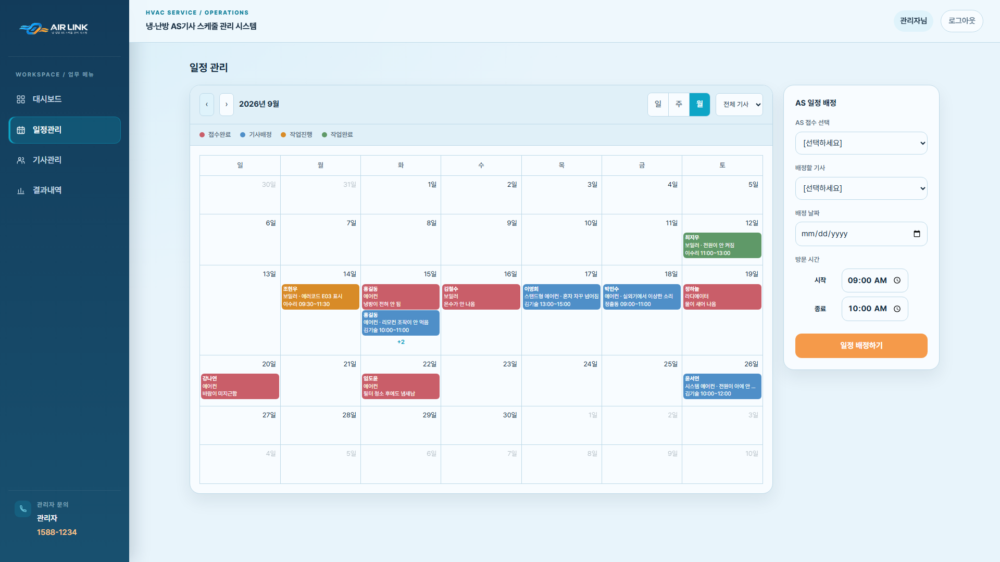

# AIR LINK — 냉·난방 AS기사 스케줄 관리 시스템

> 고객 접수 → **관리자 배정** → 기사 보고 → 만족도로 이어지는 A/S 순환 구조에서, 관리자가 기사에게 일을 배정하는 화면


## 한눈에 보기

| 구분 | 내용 |
| --- | --- |
| 팀·기간 | 4인 · 2026.09.08 ~ 09.17 (10일) |
| **내 담당** | **관리자 일정 관리 화면 전체 — Controller 부터 CSS 까지 (약 1,150줄)** |
| 기술 | Java 17 · Spring Boot · MyBatis · MariaDB · Thymeleaf · FullCalendar |
| 원본 저장소 | [`ung-Jin/Schedule`](https://github.com/ung-Jin/Schedule) 의 fork |
| 작업일지 | [Notion](https://scratched-ceramic-15c.notion.site/40090bcc7b0780409d99e0e6757d8e30) |

세 프로젝트 중 **처음이자 가장 짧았던** 과제입니다. 화면 하나를 받아 **화면 → JS → Controller → Service → Mapper → DB** 한 세로줄을 끝까지 맡았습니다.

## 내가 만든 것

| | 하는 일 | 파일 |
| --- | --- | --- |
| **일정 캘린더** | 기준 날짜가 다른 접수와 배정을 한 달력에 · 상태별 4색 | [`admin_schedule.js`](src/main/resources/static/js/pages/schedule/admin_schedule.js) 373줄 |
| **기사 배정** | 날짜·시간을 따로 받아 전송 직전 하나로 · 배정과 접수 상태 변경을 한 흐름으로 | [`ScheduleService`](src/main/java/com/green/Schedule/schedule/service/ScheduleService.java) 51줄 |
| **중복 배정 검증** | 같은 기사의 시간대 겹침 차단 · 충돌한 기사명과 시간을 에러에 같이 | [`admin_schedule.js#L214`](src/main/resources/static/js/pages/schedule/admin_schedule.js#L214) |
| **조회 쿼리** | 스케줄 · 기사 · 접수를 한 번에, 조회 전용 resultMap 으로 | [`schedule-mapper.xml`](src/main/resources/mapper/schedule-mapper.xml) 129줄 |
| **화면 틀·스타일** | 달력 레이아웃, 배정 폼, 범례 | [`admin_schedule.css`](src/main/resources/static/css/pages/schedule/admin_schedule.css) 353줄 |

<details><summary>팀원 담당</summary>

접수·기사 보고·만족도 조사·회원/로그인은 팀원 담당입니다.

</details>

## 화면



접수(희망일)와 배정(확정일)이 한 달력에 올라가고, 상태를 색으로 구분합니다. 하루에 일정이 몰리면 **`+N` 으로 접어** 칸이 터지지 않게 했습니다.

## 핵심 코드

| 주제 | 판단 | 코드 |
| --- | --- | --- |
| 두 기준 날짜를 한 달력에 | 접수는 `wishDate`(희망일), 배정은 `fixDate`(확정일)로 **기준이 다르다**. 이미 배정된 접수는 빼서 같은 건이 두 번 나오지 않게 했다 | [`admin_schedule.js#L22`](src/main/resources/static/js/pages/schedule/admin_schedule.js#L22) |
| 하루에 몰릴 때 | FullCalendar 기본 "+more" 를 끄고 **직접 접었다**. 기본 동작은 날짜를 이동시켜 버려서 기사 대시보드와 흐름이 달라진다 | [`admin_schedule.js#L101`](src/main/resources/static/js/pages/schedule/admin_schedule.js#L101) |
| 시간 겹침 판별 | 구간 겹침을 **한 줄로**. 네 경우를 나눠 쓰면 경계에서 틀린다 | [`admin_schedule.js#L225`](src/main/resources/static/js/pages/schedule/admin_schedule.js#L225) |
| 기사 필터 | 서버를 다시 부르지 않고 **받아 둔 목록을 그 자리에서 다시 거른다**. 10일짜리 과제에 기사 5명이라 서버 왕복이 더 비싸다 | [`admin_schedule.js#L22`](src/main/resources/static/js/pages/schedule/admin_schedule.js#L22) |
| 배정과 상태 변경 | 일정 저장과 접수 상태 `ASSIGNED` 변경을 **한 흐름으로**. 따로 두면 하나만 성공했을 때 접수가 떠 있는 채로 남는다 | [`ScheduleService#L41`](src/main/java/com/green/Schedule/schedule/service/ScheduleService.java#L41) |
| 조회 전용 resultMap | 공용 resultMap 을 돌려쓰지 않고 **이 조회에서 실제로 SELECT 되는 열만** 매핑 (아래 문제 해결) | [`schedule-mapper.xml#L17`](src/main/resources/mapper/schedule-mapper.xml#L17) |

```js
// 두 구간이 겹치는가 — 시작이 상대 끝보다 앞이고, 상대 시작이 내 끝보다 앞이면 겹친다
return startTime < existingEnd && existingStart < endTime;
```

## 문제 해결

**상태값이 세 군데에 똑같이 들어갔다**

스케줄 목록을 조회했더니 `schedule.status` · `engineerDTO.status` · `requestDTO.status` 가 **전부 같은 값**이었습니다. 기사 상태(`WORK`)도, 접수 상태(`ASSIGNED`)도 전부 스케줄 상태로 덮여 있었습니다.

SQL 이 아니라 **resultMap 재사용**이 원인이었습니다.

```sql
SELECT ... , S.STATUS AS STATUS     -- STATUS 는 이 하나뿐이다
FROM AS_SCHEDULE S
LEFT JOIN ENGINEER E ON ...
LEFT JOIN REQUEST  R ON ...
```

쿼리가 돌려주는 `STATUS` 는 하나인데 `engineer` 와 `request` resultMap **둘 다** `STATUS` 를 매핑하고 있었습니다. `association` 으로 그대로 재사용하니 그 하나뿐인 열이 중첩 객체 세 곳에 전부 들어갔습니다.

컬럼에 별칭을 더 붙이는 대신 **이 조회 전용 resultMap 을 따로** 만들었습니다. 실제로 SELECT 되는 열만 매핑하니 `STATUS` 가 애초에 들어갈 자리가 없습니다.
→ [`schedule-mapper.xml#L17`](src/main/resources/mapper/schedule-mapper.xml#L17)

**배운 것** — resultMap 을 돌려쓰면 코드는 짧아지지만, **열 이름이 겹치는 순간 조용히 틀립니다.** 에러도 안 나고 값만 바뀌어 있어서 찾는 데 시간이 걸렸습니다. 조회마다 필요한 열이 다르면 **조회 전용 resultMap 을 따로 두는 쪽**이 안전합니다.

## 한계

- 중복 배정 검증이 **화면에서만** 이뤄집니다. 같은 요청을 직접 보내면 막히지 않아, 서버에서도 한 번 더 봐야 합니다.
- 기사 근무 시간(`WORK_START_TIME`·`WORK_END_TIME`)을 배정할 때 보지 않습니다.
- 배정 취소·변경 화면이 없습니다. 10일 안에 접수→배정→보고 흐름을 먼저 세웠습니다.

## 실행 방법

1. MariaDB 에 `project-1` 데이터베이스를 만들고 `테이블생성쿼리.sql` 을 실행합니다 (표 6개와 더미 데이터가 함께 들어 있습니다).
2. `application.yaml` 의 `datasource` 를 자신의 DB 에 맞춥니다.
3. 서버를 실행하고 `admin` / `asdf` 로 로그인한 뒤 **일정 관리**로 들어갑니다.

> 더미 데이터의 일정은 2026년 9월에 몰려 있습니다. 달력을 9월로 옮기면 보입니다.

## 배운 점

1. **짧아지는 코드가 늘 좋은 건 아닙니다.** resultMap 을 돌려쓰면 줄은 줄지만 열 이름이 겹치는 순간 에러 없이 틀립니다.
2. **기준이 다른 데이터를 한 화면에 올릴 때는 기준부터 정합니다.** 접수는 희망일, 배정은 확정일이라는 걸 먼저 못 박고 나서야 달력이 정리됐습니다.
3. **화면 검증은 서버 검증이 아닙니다.** 이 과제에서는 화면에서만 막았는데, 다음 과제부터는 같은 규칙을 서버에서도 확인했습니다.

## 프로젝트 시리즈

**1차 AS기사 스케줄 관리 (이 저장소)** · [2차 전력사용량 예측 대시보드](https://github.com/rlawns2848-hue/Predict) · [3차 해상교통 안전경로 예측](https://github.com/rlawns2848-hue/Navigate)

